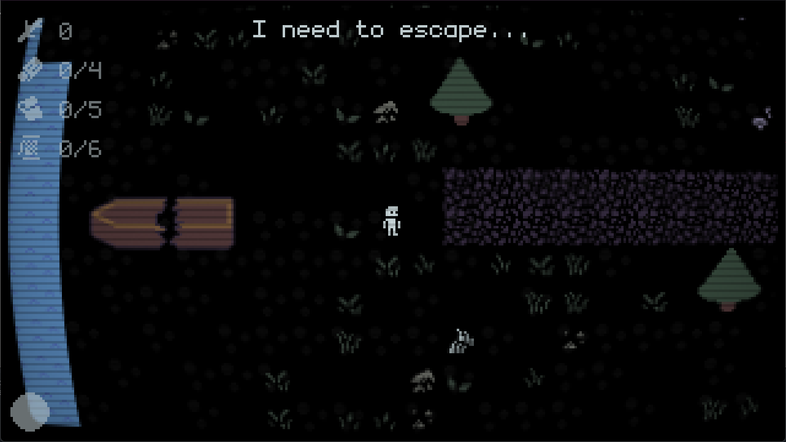
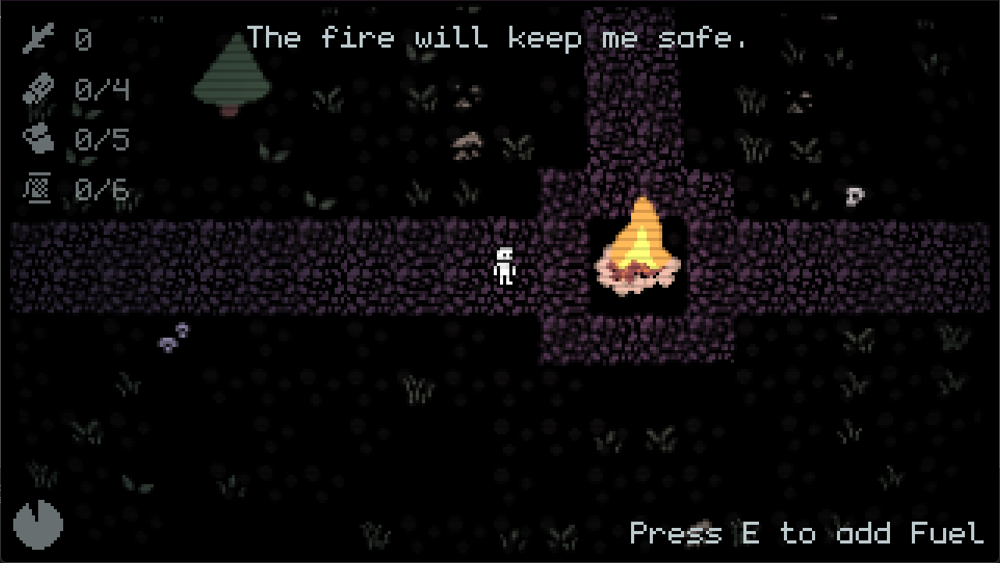
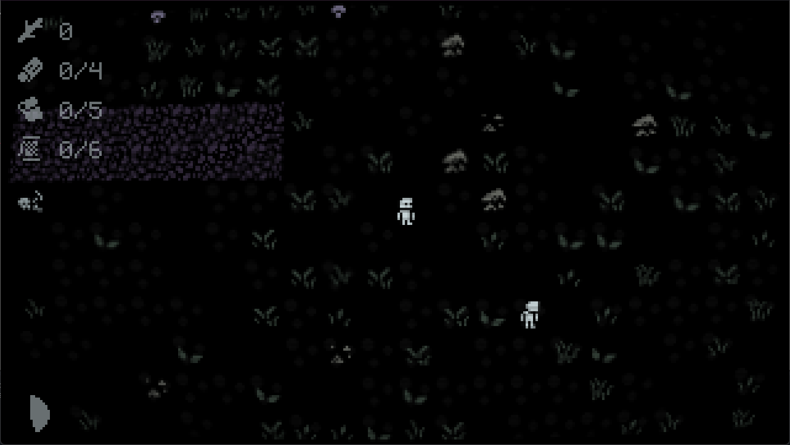
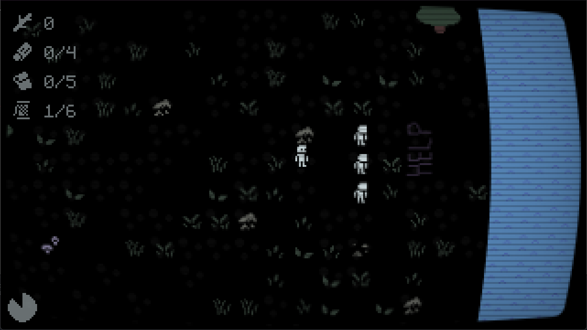

# Lone Island

Lone Island follows you, being stranded on a remote island no one has heard of. You need to find materials to repair your boat while avoiding the terrors hidden, somewhere...

  

I have worked on a few different game before, like survival, rpg, sandbox etc., but I never made a horror game, last time I made one was in Geometry Dash. So I decided to try and make one in a real game engine, and it was fun!

I did not try to make the game extremely scary, but it will still spook you, it spooked me while playtesting!

# How to play

The game runs directly in your browser and can be played on itch: https://wirelessnine.itch.io/lone-island

The game is very simple, you have to find wood, cloth and rope to repair your boat and escape. You have a campfire and you can feed it sticks to keep you safe at night, the monster can't get you if you are next to it, but you can still explore at night. Be careful! The island has a limited amount of sticks, so use them carefully! You can press SHIFT to sprint.

After getting all the materials needed, run to the boat and escape!

  

The game was a bit rushed because I'm going to an event in the weekend, so there might be small glitches, but there should not be any major bugs. Anyway, I hope you enjoy this little game!

  

  

